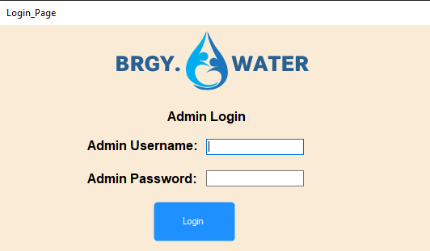
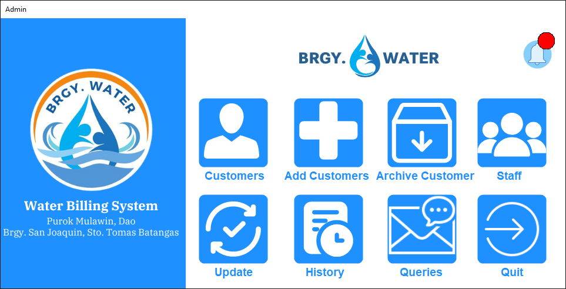
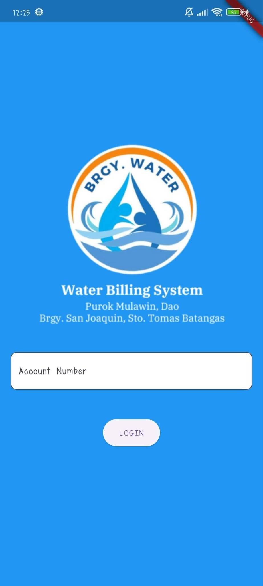
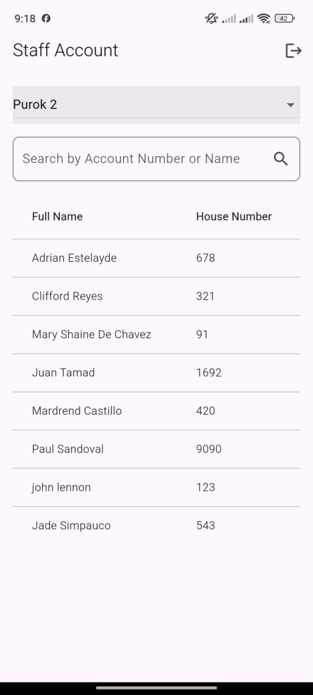
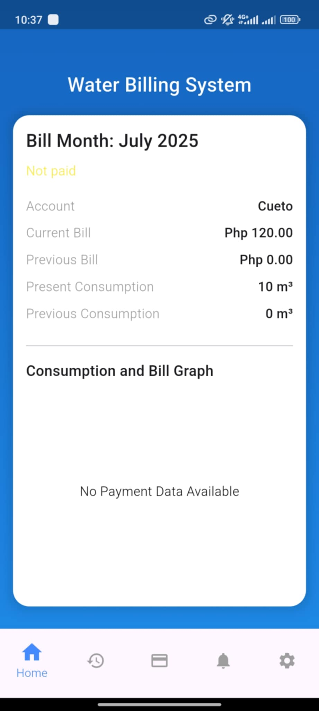
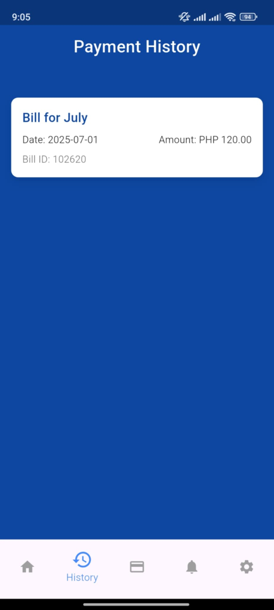

<div align="center">

# Brgy. Water — Water Billing System

**A connected water billing platform for a barangay waterworks system: admin desktop app, staff mobile app, and customer mobile app, with online payments.**


</div>

---

## Overview

Brgy. Water replaces manual water billing with one system shared by three kinds of users. Staff record each household's water meter reading, the system computes the bill, and customers see their bills in the app and pay online through **PayMongo**. The admin oversees everything from a desktop application.

| App | Users | Platform |
|---|---|---|
| **Admin Desktop** | Administrator | Windows desktop (C#, Windows Forms .NET) |
| **Staff App** | Meter readers / billing staff | Mobile (Flutter) |
| **Customer App** | Households / water consumers | Mobile (Flutter) |

All three apps share the same Firebase backend, so a reading entered by staff shows up as a bill on the customer's phone and in the admin's records.

```
   Staff App ──(meter readings)──┐
                                 ▼
                      ┌────────────────────┐        ┌───────────────┐
 Admin Desktop ◄────► │      Firebase      │ ◄────► │   PayMongo    │
                      └────────────────────┘        └───────────────┘
                                 ▲                         ▲
   Customer App ──(view bills)───┘────(pay online)─────────┘
```

---

## Admin Desktop App

<div align="center">

| Admin Login | Admin Dashboard |
|:---:|:---:|
|  |  |

</div>

- Secure admin login with username and password
- Home menu with one-click access to:
  - **Customers**: view and manage all customer accounts
  - **Add Customers**: register new households
  - **Archive Customer**: archive inactive accounts without losing their records
  - **Staff**: manage staff accounts
  - **Update**: update records and billing information
  - **History**: billing and payment history
  - **Queries**: handle customer inquiries
- Notification indicator for new activity

---

## Staff Mobile App

<div align="center">

| Staff Login | Customer List |
|:---:|:---:|
|  |  |

</div>

- Login using an account number
- Customer list filtered by **Purok** (zone) from a dropdown
- Search customers by **account number or name**
- Customer details at a glance: full name and house number
- Used in the field to record water meter readings that feed into the billing

---

## Customer Mobile App

<div align="center">

| Home / Current Bill | Payment History |
|:---:|:---:|
|  |  |

</div>

- Login using an account number
- **Current bill** for the month with a paid / not-paid status
- Current and previous bill, plus present and previous consumption in m³
- Consumption and bill graph
- **Payment history** listing past bills with date, amount, and bill ID
- **Online payment** through the **PayMongo** gateway
- Bottom navigation for Home, History, Payments, Notifications, and Settings

---

## How It Works

1. **Admin** registers customers and staff accounts
2. **Staff** read each household's water meter and record the consumption in the staff app
3. The **bill is computed** from the reading and saved to Firebase
4. The **customer** sees the new bill, consumption, and graph in their app
5. The customer **pays through PayMongo**, and the payment shows up in their history and in the admin's records

---

## Tech Stack

| Layer | Technology |
|---|---|
| Admin desktop app | C#, Windows Forms (.NET) |
| Staff & customer mobile apps | Flutter / Dart |
| Backend & database | Firebase |
| Payments | PayMongo payment gateway |

---

## Source Code

This is a **client project**, so the source code is private and not publicly available. This repository is a showcase of the system only.

If you'd like to know more about how it was built, feel free to reach out through my GitHub profile: **[github.com/jhaylm-dev](https://github.com/jhaylm-dev)**.

---

## Author

Full stack development of the whole platform: the Flutter customer/staff app, the C# Admin Windows Forms Application, and the Firebasse with its realtime-database design.

**Jhay Landrei B. Marcelino**: Full-Stack Software Developer (Flutter, Dart, Go, Python, C#/.NET) based in Laguna, Philippines.

---

## Notes

Screenshots use sample/demo data. This repository is a portfolio showcase of a client project; the source code is not included.

© 2025 Water Billing System. All rights reserved.
